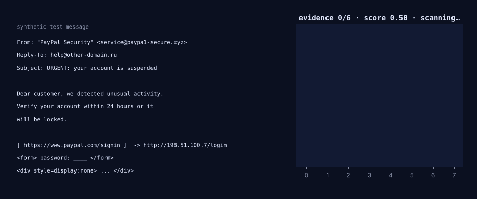
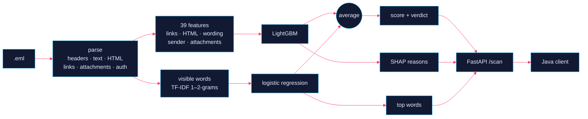
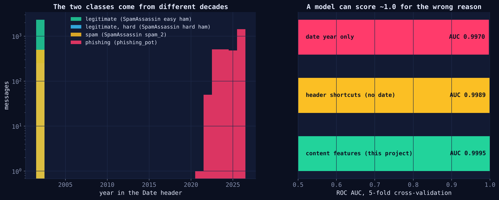
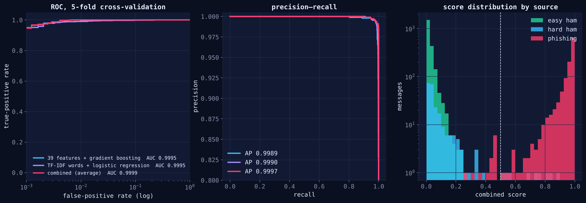
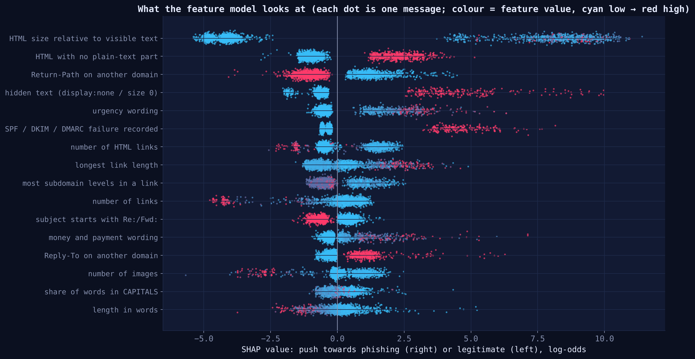
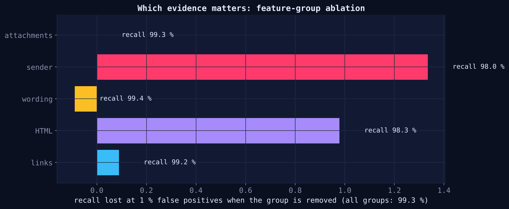
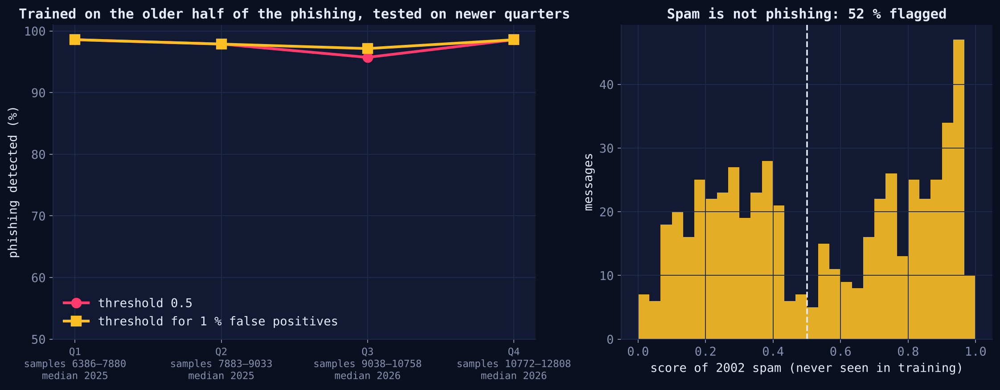
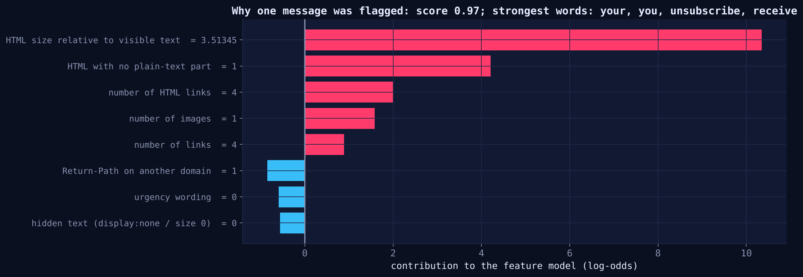

<p align="center"></p>

<p align="center">


</p>

<h3 align="center">A phishing detector that says <i>why</i>: 39 readable features, a text model, SHAP explanations,<br>an HTTP API and a Java client. And an honest test of what its 99.9 % really means.</h3>

Phishing is still the most common way into an organization: a convincing e-mail, a link to a fake login page, a password typed in. **phishguard** reads a raw e-mail (`.eml`), extracts the evidence a security analyst would look at (links that lie about where they go, hidden text, forms, urgency, brand names sent from the wrong domain, risky attachments), scores it with gradient boosting and a TF-IDF text model, and returns the score together with the reasons.

It is trained and evaluated on **real phishing**: e-mails received by long-exposed addresses and published for defensive research in [rf-peixoto/phishing_pot](https://github.com/rf-peixoto/phishing_pot) (2022–2026), against legitimate mail from the [Apache SpamAssassin public corpus](https://github.com/stdlib-js/datasets-spam-assassin).

<table>
<tr>
<td align="center" width="25%"><h2>0.9999</h2><sub>ROC AUC, combined model,<br>5-fold cross-validation<br>(95 % CI 0.9997–1.0000)</sub></td>
<td align="center" width="25%"><h2>0.997</h2><sub>AUC of a model that sees<br><b>only the year</b> in the Date header.<br>Read the shortcut test.</sub></td>
<td align="center" width="25%"><h2>3.4 %</h2><sub>false positives on "hard ham":<br>legitimate HTML newsletters<br>(0.09 % on ordinary mail)</sub></td>
<td align="center" width="25%"><h2>96–99 %</h2><sub>recall on newer phishing when<br>trained only on the older half<br>(temporal drift test)</sub></td>
</tr>
</table>

<p align="center"></p>
<p align="center"><sub>The API's explanation for a synthetic test message (in <a href="examples">examples/</a>): each bar is one feature's SHAP contribution, added one at a time.</sub></p>

---

## ⛨ Run it

```bash
pip install -r requirements.txt
bash scripts/fetch_data.sh                      # ~600 MB of raw e-mail into data/raw (pinned commits, fixed subset)
python experiments/build_dataset.py             # parse, extract features → data/messages.parquet (35 s)
python experiments/run_all.py                   # all experiments, figures, models/phishguard.joblib (30 s)
python -m pytest -q                             # tests

uvicorn api.app:app --port 8000                 # the HTTP API
curl -s --data-binary @examples/synthetic_phish.eml localhost:8000/scan
```

```bash
# Java client (no dependencies, Java 11+)
javac -d out java/src/main/java/io/github/jafarsalim/phishguard/PhishGuardClient.java
java -cp out io.github.jafarsalim.phishguard.PhishGuardClient http://localhost:8000 examples/*.eml
legitimate  0.361  synthetic_ham.eml    | HTML size relative to visible text; Return-Path on another domain; length in words
phishing    0.988  synthetic_phish.eml  | HTML size relative to visible text; hidden text (display:none / size 0); urgency wording
```

The full transcript of the API and Java demo is in [`results/api_demo.txt`](results/api_demo.txt). The raw e-mails are **not** redistributed here (phishing_pot is CC BY-NC 4.0); `fetch_data.sh` downloads the exact subset listed in [`experiments/subsets.txt`](experiments/subsets.txt) from pinned commits.



## ⛨ The features

Every feature is something an analyst can check by eye. None of them is a date, a server name or a header that only says which mail system carried the message (see the shortcut test for why).

| Group | Features |
|:--|:--|
| **Links** (12) | number of links and of link domains; link to a bare IP; URL shortener; `@` in a link host; punycode look-alike domain; high-abuse top-level domain; longest link; most subdomain levels; share of links leaving the sender's domain; **link text that shows one domain while the link goes to another**; number of HTML links |
| **HTML** (7) | HTML with no plain-text part; form; script; iframe; images; hidden text (`display:none`, zero font size); HTML size relative to the visible text |
| **Wording** (9) | length; urgency (*verify, suspended, within 24 hours, action required* ...); credential words (*password, sign in, account* ...); money words; "click here" calls to action; share of words in capitals; exclamation marks; subject length; `Re:`/`Fwd:` subject |
| **Sender** (8) | brand named in the display name or subject; **brand named but not the sender's domain**; Reply-To and Return-Path on other domains; an address inside the display name; number of recipients; free-mail sender; SPF/DKIM/DMARC failure recorded by the receiving server |
| **Attachments** (3) | number; risky type (`.html`, `.zip`, `.iso`, `.exe`, `.js`, macro documents, `.svg` ...); PDF |

The text model adds the visible words: TF-IDF of words and word pairs, logistic regression with balanced classes. The final score is the average of the two probabilities.

## ⛨ The data

| Source | Messages | English (used) | Role |
|:--|--:|--:|:--|
| phishing_pot (random 3,000 of 12,864) | 3,000 | 1,124 | phishing and scam e-mails, 2022–2026 |
| SpamAssassin easy ham | 2,317 | 2,195 | legitimate (mailing lists, newsletters, personal mail), 2002 |
| SpamAssassin hard ham | 250 | 233 | legitimate but spam-like (HTML marketing, unusual formats), 2002 |
| SpamAssassin spam_2 | 590 | 556 | unsolicited bulk mail, 2002 (stress test only, never trained on) |

Non-English messages are set aside ([`phishguard/lang.py`](phishguard/lang.py)): all the legitimate mail is English while most phishing samples (1,876 of 3,000) are not, so a mixed benchmark would let a model separate the classes by *language*.

## ⛨ The shortcut test: read this before the scores

<p align="center"></p>

The only public legitimate-mail corpora with full headers are old (SpamAssassin is from 2002; Enron from 2001); real phishing collections are recent. So the two classes come from different decades, and a model can tell them apart without understanding anything about phishing:

| Model given only... | AUC (5-fold CV) |
|:--|--:|
| the **year** in the Date header | **0.9970** |
| which infrastructure headers are present (DKIM signature, ARC seal, Microsoft/Google headers, X-Mailer, number of Received lines), no date | **0.9989** |
| the 39 content features of this project | 0.9995 |

A detector that scores 0.997 by reading the date is useless. This is why phishguard excludes dates, Received chains and infrastructure headers from its features. But the test also shows the limit of *any* number measured on such data: style changed between 2002 and 2025 too (HTML-only mail is now the norm; plain-text mailing lists were the norm then), and some content features carry part of that change. The SHAP summary below shows it plainly: "HTML size relative to visible text" and "HTML with no plain-text part" are the top features, and "Return-Path on another domain" pushes towards *legitimate*, because 2002 mailing-list software rewrote it.

**What the scores below mean, then:** the model separates *this* phishing from *this* legitimate mail almost perfectly; on an era-matched corpus (your own organization's mail and the phishing it receives) expect lower numbers, and retrain on it. The two measurements that are least affected by the era gap are the hard-ham false-positive rate (legitimate HTML marketing, the closest thing to phishing in style) and the drift test (phishing only, old versus new).

## ⛨ Results

### Cross-validation

<p align="center"></p>

1,124 phishing and 2,428 legitimate English messages, stratified 5-fold cross-validation, threshold 0.5:

| Model | ROC AUC (95 % CI) | Avg. precision | Precision | Recall | F1 | FPR easy ham | FPR hard ham |
|:--|--:|--:|--:|--:|--:|--:|--:|
| 39 features + LightGBM | 0.9995 (0.9990–0.9998) | 0.9989 | 99.1 % | 98.6 % | 0.988 | 0.09 % | 3.4 % |
| TF-IDF + logistic regression | 0.9995 (0.9990–0.9998) | 0.9990 | 99.2 % | 98.7 % | 0.989 | 0.05 % | 3.4 % |
| **combined** | **0.9999 (0.9997–1.0000)** | **0.9997** | 99.1 % | **98.9 %** | **0.990** | 0.09 % | 3.4 % |

*Intervals: stratified bootstrap of the out-of-fold predictions.*

The 3.4 % on hard ham (8 of 233 messages) is the number to watch: legitimate HTML marketing with images, tracking links and urgent offers is where a phishing detector makes its false alarms.

### What the model looks at

<p align="center"></p>

<p align="center"></p>

Removing feature groups one at a time (recall at 1 % false positives, all groups: 99.3 %): without the **sender** group recall falls to 98.0 %, without **HTML** to 98.3 %, without **links** to 99.2 %; wording and attachments change nothing measurable here. The evidence is redundant: phishing betrays itself in several independent ways, which is what makes a detector robust to an attacker who fixes one of them.

### Drift and spam

<p align="center"></p>

**Drift.** Trained on the older half of the phishing samples (by sample number; Date-header years mostly 2022–2025, median 2024) and half of the legitimate mail, tested on the newer half split into four quarters:

| Newer quarter | Median year | Recall at 0.5 | Recall at 1 % FPR |
|:--|--:|--:|--:|
| Q1 | 2025 | 98.6 % | 98.6 % |
| Q2 | 2025 | 97.9 % | 97.9 % |
| Q3 | 2026 | 95.7 % | 97.1 % |
| Q4 | 2026 | 98.6 % | 98.6 % |

No steady decline over roughly two years: the features describe *how* phishing works, which changes slower than *what* it says.

**Spam is not phishing.** 2002 spam (never seen in training) gets a score above 0.5 in 52 % of cases. Bulk advertising shares the HTML style and calls to action of phishing but rarely asks for credentials; a deployment should treat phishguard's score as one signal next to a spam filter, not as a spam filter.

### One message, explained

<p align="center"></p>

A real phishing message from the test data (score 0.97; no addresses or links shown). The HTML-to-text ratio, the HTML-only format and the number of links push it up; its Return-Path and the absence of urgency words push it down; the strongest words of the text model are its marketing phrasing ("unsubscribe", "to receive"). This is what the API returns for every message, so an analyst can see *why* a message was flagged and disagree with it.

## ⛨ API

`POST /scan` with the raw message as the body:

```json
{
  "score": 0.988, "verdict": "phishing", "score_features": 1.0, "score_text": 0.975,
  "reasons": [
    {"feature": "html_text_ratio", "description": "HTML size relative to visible text", "value": 2.02, "contribution": 6.41},
    {"feature": "hidden_text", "description": "hidden text (display:none / size 0)", "value": 1.0, "contribution": 4.33},
    {"feature": "urgent_words", "description": "urgency wording", "value": 10.0, "contribution": 2.79}
  ],
  "words": [{"term": "your", "contribution": 0.68}, {"term": "account", "contribution": 0.51}],
  "model": "phishguard 1.0.0"
}
```

`GET /health` reports the model version and threshold. Environment variables: `PHISHGUARD_MODEL` (path to the joblib file), `PHISHGUARD_THRESHOLD` (default 0.5). Messages over 10 MB are refused. The Java client ([`PhishGuardClient.java`](java/src/main/java/io/github/jafarsalim/phishguard/PhishGuardClient.java)) wraps it in one call, `new PhishGuardClient(url).scan(path)`, for use in a mail gateway or a Spring service.

## ⛨ Limits

* **The benchmark has an era gap** (shortcut test above). Retrain on your own mail before trusting the numbers.
* **English only** in this evaluation; the features work in any language, the text model needs data in that language.
* **No URL or attachment detonation**: the detector never follows links or opens attachments. Combine it with URL reputation and sandboxing.
* **An adaptive attacker** who knows the features can avoid some of them (plain-text phishing with no links exists). The redundancy across feature groups raises the cost, it does not remove the possibility.

## ⛨ Repository map

```
phishing-email-detector-ml/
├── phishguard/
│   ├── parse.py          raw .eml → text, HTML, links, attachments, auth results
│   ├── features.py       the 39 features (+ shortcut headers, used only in the shortcut test)
│   ├── lang.py           English filter
│   └── model.py          Detector: LightGBM + TF-IDF/LR, SHAP explanations, save/load
├── api/app.py            FastAPI service
├── java/                 PhishGuardClient.java
├── experiments/
│   ├── build_dataset.py  parse the raw messages once
│   ├── run_all.py        shortcut test, CV, SHAP, ablation, drift, spam, example
│   ├── make_gif.py       assets/scan.gif
│   └── subsets.txt       the exact messages used
├── scripts/fetch_data.sh
├── examples/             two synthetic test messages
├── tests/                pytest
├── figures/  results/  assets/
```

## ⛨ References

1. I. Fette, N. Sadeh and A. Tomasic, "Learning to detect phishing emails," *WWW*, 2007.
2. S. Salloum, T. Gaber, S. Vadera and K. Shaalan, "A systematic literature review on phishing email detection using natural language processing techniques," *IEEE Access*, vol. 10, 2022.
3. S. M. Lundberg and S.-I. Lee, "A unified approach to interpreting model predictions," *NeurIPS*, 2017.
4. G. Ke et al., "LightGBM: a highly efficient gradient boosting decision tree," *NeurIPS*, 2017.
5. R. Geirhos et al., "Shortcut learning in deep neural networks," *Nature Machine Intelligence*, 2(11), 2020.
6. rf-peixoto, *phishing_pot: a collection of phishing samples for researchers and detection developers*, GitHub (CC BY-NC 4.0).
7. Apache SpamAssassin public mail corpus (2002), via stdlib-js/datasets-spam-assassin (CC0).

## ⛨ Cite

```bibtex
@software{salim_phishguard_2026,
  author = {Salim, Jaafar},
  title  = {phishguard: Explainable Phishing-Email Detection with a Shortcut Test},
  year   = {2026},
  url    = {https://github.com/jafarSalim/phishing-email-detector-ml}
}
```

<p align="center"><sub>MIT licence (code) · Eng. Jaafar Salim · for defensive research and education</sub></p>
